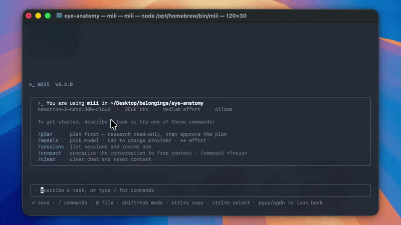

<h1 align="center">miii — open-source AI coding agent for your terminal</h1>

<p align="center">
  <strong>A free, local-first alternative to Claude Code, Cursor and GitHub Copilot.</strong><br>
  It plans, edits, runs and tests code. Use any model: Claude, GPT, Gemini, DeepSeek,<br>
  or run it 100% offline with Ollama, LM Studio, llama.cpp or vLLM.
</p>

<p align="center">
  <a href="https://www.npmjs.com/package/miii-agent"></a>
  <a href="LICENSE"></a>
  <a href="https://nodejs.org"></a>
  
  
  <a href="https://github.com/sponsors/maruakshay"></a>
</p>

<p align="center">
  
</p>

<p align="center"><em>Apna code, apna model, apni marzi.</em> · Free forever · Made in India 🇮🇳</p>

## Why miii?

- **Free and open source.** MIT-licensed, with no account, subscription or paid tier.
- **Any LLM, one CLI.** 14+ providers, and you can switch mid-session with `/provider`.
- **Private by default.** With a local model, your code never leaves `localhost`, and there's no telemetry.
- **You stay in control.** Every file write and shell command asks first, and `/rewind` undoes anything.

## Quick start

```bash
npm i -g miii-agent
```

**Local, offline LLM (free):**
```bash
ollama pull qwen3-coder:30b
miii
```

**Hosted model (uses keys you already have, like `ANTHROPIC_API_KEY` or `OPENAI_API_KEY`):**
```bash
miii provider add gemini
miii
```

Then ask it to do things:
```
> refactor the auth module to use async/await
> @src/server.ts add rate limiting to all POST routes
> why are my tests failing in utils/parser.ts
```

**Prefer a browser?** `miii web` opens a desktop-style chat UI with the same agent, sessions and permission rules. It only listens on `localhost` and needs a one-time key to connect.

> [!TIP]
> **Windows:** `irm https://raw.githubusercontent.com/maruakshay/miii-cli/main/install.ps1 | iex` (needs Node 18+).

## Supported LLM providers

| ☁️ Hosted (bring your own API key) | 🏠 Local (free, offline) |
| :--- | :--- |
| Anthropic Claude · OpenAI GPT · Google Gemini · DeepSeek · Mistral · Groq · Cerebras · xAI Grok · OpenRouter · Together | Ollama · LM Studio · llama.cpp · vLLM |

Tool calling is what makes an agent usable. `qwen3-coder` and `devstral` are trained for it, and miii repairs malformed tool calls from other models.

## Features

- **📋 Plan mode.** `/plan` researches your code read-only and proposes a plan. Nothing is written until you approve it.
- **✅ Live task list.** The agent's checklist stays pinned above the input, with a progress bar that fills as tasks finish.
- **🎯 Turn receipts.** Each turn ends with ✓, a coloured `+42 −10` diffstat and the test result, and a running total of changes stays on screen.
- **🔁 Fix until green.** `miii fix` runs your tests, fixes what fails and repeats until they pass. Attempts that don't help are rolled back.
- **⚖️ Done-check.** A second, smaller model checks the work is really finished before the agent stops.
- **⟲ Rewind and checkpoints.** Undo the agent's file changes and the conversation together.
- **⚡ Mid-turn steering.** Type corrections while the agent runs, and it picks them up on its next step.
- **🔔 Notifications.** The terminal rings when a long turn finishes or needs your approval.
- **🧩 Subagents, MCP and hooks.** Delegate searches, connect GitHub or Postgres over the Model Context Protocol, and run shell hooks on tool events.
- **🖥️ Headless mode for CI.** `miii -p "prompt"` lets you script it, pipe in `git diff`, or run it in CI/CD pipelines.

<details>
<summary><strong>All slash commands</strong></summary>

`/plan` · `/models` · `/provider` · `/agents` · `/mcp` · `/permissions` · `/rewind` ·
`/sessions` · `/memory` · `/context` · `/compact` · `/cost` · `/review` · `/init` ·
`/export` · `/copy` · `/settings` · `/vim` · `/new` · `/clear`
</details>

<details>
<summary><strong>Why the UI works this way (the neuroscience of reward)</strong></summary>

- **Rewards only for real progress.** Dopamine responds to *unexpected* reward and fades for rewards you can predict (Schultz et al., 1997). So the green ✓ appears only when files changed or tests passed. A plain answer gets a quiet check.
- **Useful information during the wait.** Uncertain outcomes keep the reward system active (Fiorillo et al., 2003). Instead of a bare spinner, the status line shows what the agent is doing, how long it has taken and how many tokens it has written.
- **Progress you can see.** People speed up as a goal gets closer (Kivetz et al., 2006), so the task list has a progress bar.
- **No random rewards.** Every signal comes from a real diff, test result or finished turn.

<sub>Design inspiration, not a clinical claim.</sub>
</details>

## Pick a local model for your GPU

| VRAM | Model | Size |
| :--- | :--- | :--- |
| < 4 GB | `qwen2.5-coder:3b` | 1.9 GB |
| 8 GB | `qwen2.5-coder:7b` | 4.7 GB |
| 12–16 GB | `qwen2.5-coder:14b` | 9.0 GB |
| 24 GB+ | `qwen3-coder:30b` ⭐ | 18.6 GB |

Apple Silicon works well, since unified memory counts as VRAM.

## FAQ

<details>
<summary><strong>Is miii a free alternative to Claude Code and Cursor?</strong></summary>

Yes. miii gives you the same plan → edit → run → verify workflow, MIT-licensed and with no subscription. You only pay your model provider, or nothing if you run a local model.
</details>

<details>
<summary><strong>Does miii work offline?</strong></summary>

Yes. With Ollama, LM Studio, llama.cpp or vLLM, everything stays on your machine. That suits air-gapped work, code under NDA, or a flight with no wifi. The only call miii makes by itself is an npm version check.
</details>

<details>
<summary><strong>Can it break my repo?</strong></summary>

Every write and shell command asks for approval first, and file tools are limited to the working directory. If something does go wrong, `/rewind` restores both the files and the conversation.
</details>

<details>
<summary><strong>Do I need a GPU?</strong></summary>

No. Any laptop works with a hosted provider. For local models a GPU helps: `qwen2.5-coder:3b` runs on a CPU, but slowly.
</details>

## Sponsor and contribute

miii is built independently in India. Sponsorship pays for the GPU time and API costs of testing it against every model. You can sponsor through [GitHub Sponsors](https://github.com/sponsors/maruakshay).

Issues and PRs are welcome. The web UI lives in `web/` (React, Vite, Tailwind), and `npm run dev:web` starts it.

---

<p align="center">
  <strong>⭐ Star miii if you think great coding tools should be free for everyone.</strong><br>
  <sub>MIT © <a href="https://github.com/maruakshay">maruakshay</a></sub>
</p>
